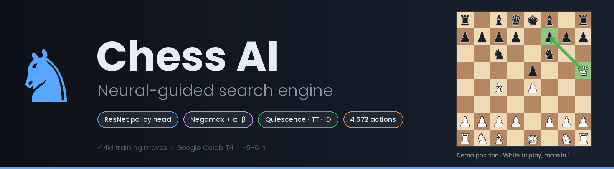
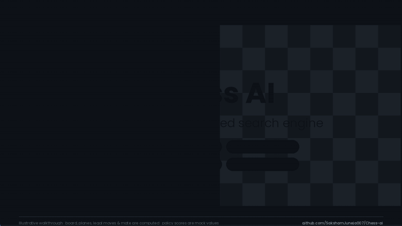
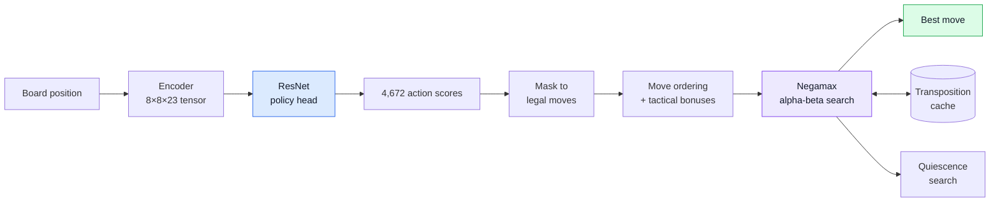

**Chess AI is a hybrid chess engine.** A ResNet policy network decides *which moves are worth looking at first*; classical adversarial search then works out *what actually happens* if they are played.

[🎬 Demo](#demo) · [🧭 How it works](#how-it-works) · [🧠 The network](#the-network) · [🔍 Search](#search) · [🚀 Quick start](#quick-start) · [🗂 Structure](#project-structure) · [🛣 Roadmap](#roadmap)

---

## Demo

[](assets/demo.mp4)

▶ **[Watch the full 70-second walkthrough](assets/demo.mp4)** (`assets/demo.mp4`)

The clip follows a single decision — *encode → policy head → move ordering → alpha-beta search → result* — on a real position where White has a mate in one (`Qxf7#`).
The board, the 23 feature planes, the legal-move mask in the 4,672-action space, the ordering arithmetic and the mate are all **computed**. The policy probabilities shown in the clip are **illustrative mock values**, not output from the trained weights.

---

## Highlights

| | |
|---|---|
| 🧠 **Learned move guidance** | ResNet with a single policy head over a 4,672-move action space, trained on ~14 million moves |
| ⚔️ **Classical search** | Negamax + alpha-beta, iterative deepening, quiescence search, check/tactical extensions, transposition cache |
| 🎯 **Hybrid ordering** | Neural score + tactical bonuses (captures, checks, promotions) decide what search tries first |
| ♟ **AlphaZero-style encodings** | 8×8×23 side-to-move input tensor and a 64×73 move-plane action index |
| ⏱ **Cheap to train** | 5–6 hours on a single Google Colab T4, using batched training with checkpoints |

---

## How it works



1. **Encode** the position into an 8×8×23 tensor from the side-to-move's perspective.
2. **Infer** — the network outputs a score for each of the 4,672 possible actions.
3. **Mask** to the moves that are legal in this position and look up their scores.
4. **Order** the legal moves by neural score plus tactical bonuses and keep the top 20.
5. **Search** the ordered moves with negamax and alpha-beta, extending forcing lines and resolving captures with quiescence search.
6. **Return** the best move found within the depth and time budget.

> The network supplies **move priors**, not position evaluations: it has a single policy head and no value head. Leaf positions are scored by the search's static evaluator.

---

## The network

| | |
|---|---|
| **Architecture** | ResNet-style CNN, single policy head |
| **Input** | `(8, 8, 23)` float32, side-to-move perspective |
| **Output** | 4,672-way policy (64 from-squares × 73 move planes) |
| **Training data** | ≈ 14 million moves |
| **Hardware** | Google Colab, NVIDIA T4 GPU |
| **Training time** | ≈ 5–6 hours |
| **Training setup** | Mini-batch training with periodic checkpoints |

### Board encoding — `encoding.py`

If Black is to move, the board is mirrored so the network always sees the player-to-move at the bottom.

| Planes | Meaning |
|:---:|---|
| 0–5 | Own pieces: P, N, B, R, Q, K |
| 6–11 | Opponent pieces: P, N, B, R, Q, K |
| 12–15 | Castling rights: own K/Q, opponent K/Q |
| 16 | En-passant target square |
| 17 | Halfmove clock ÷ 100 |
| 18 | Fullmove number ÷ 500 |
| 19–20 | Attack maps: squares attacked by own / opponent pieces |
| 21 | Threefold-repetition flag |
| 22 | Side to move is in check |

### Move encoding — `move_encoding.py`

```text
action_index = from_square × 73 + plane        (0 ≤ index < 4672)
```

| Planes | Moves |
|:---:|---|
| 0–55 | Queen-like slides: 8 directions × 7 distances (also king moves, pawn moves, castling, queen promotions) |
| 56–63 | The 8 knight jumps |
| 64–72 | Underpromotions: 3 directions × {N, B, R} |

All 4,672 outputs exist for every position, but only the legal ones are ever read. Moves are mirrored for Black exactly as the board is.

---

## Search

| Technique | What it does here |
|---|---|
| **Negamax** | One recursive function for both sides: a position's score is the negative of the opponent's |
| **Alpha-beta pruning** | Skips branches that cannot change the decision; works best when good moves come first |
| **Iterative deepening** | Searches depth 1, 2, 3 … up to 6 under a time budget (7 s default), so a move is always available |
| **Quiescence search** | Keeps playing captures, checks and promotions at the horizon so unstable positions aren't scored mid-exchange |
| **Check extension** | +1 ply when the side to move is in check |
| **Tactical extensions** | +1 ply after a capture or checking move |
| **Transposition cache** | Zobrist-keyed `(depth, score)` entries so repeated positions are searched once |
| **Neural + heuristic ordering** | Described below |

### Move ordering

```text
score = int(policy[move] × 10 000)
      + 1000   if capture
      +  500   if gives check
      +  800   if promotion
      − 1000   if queen move before fullmove 10
```

The top **20** moves survive (`TOP_K`). Neural ordering is applied at the **root** (`USE_CNN_DEPTH = 1`); deeper nodes use a cheap captures-first order so the network isn't called thousands of times per move.

### Configuration

| Setting | Default | Where |
|---|:---:|---|
| `TOP_K` — candidates kept after ordering | 20 | `searching.py` |
| `USE_CNN_DEPTH` — plies that use the network | 1 | `searching.py` |
| `MAX_DEPTH` — deepest iteration | 6 | `searching.py` |
| `time_limit` — seconds per move | 7 | `run_engine.py` |

---

## Quick start

```bash
git clone https://github.com/SakshamJuneja007/Chess-ai.git
cd Chess-ai

python -m venv .venv
source .venv/bin/activate        # Windows: .venv\Scripts\activate
pip install -r requirements.txt
```

**Add the trained model.** Weights are not stored in Git (they're ~75 MB). Put your model file in `models/` and point `MODEL_PATH` in `run_engine.py` at it.

**Ask the engine for a move:**

```python
import chess
from run_engine import get_engine_move

board = chess.Board()
print(get_engine_move(board, max_depth=6, time_limit=7))
```

**Play a demo game:**

```bash
python run_engine.py
```

### Check the encoders

```bash
python move_encoding.py          # encode ↔ decode round-trip over 200 random games
```

### Play against Stockfish

Download [Stockfish](https://stockfishchess.org/download/), set `STOCKFISH_PATH` at the top of the script, then:

```bash
python test_vs_stockfish.py      # engine (White) vs Stockfish, in the terminal
python advanced_chess_test.py    # same match with a Pygame board viewer and an eval-change plot
```

---

## Strength

Estimated playing strength: **≈ 1500 Elo** — a self-estimate, not yet a published benchmark.

To make the number reproducible, play a fixed-length match against rating-limited Stockfish and convert the score:

```python
engine.configure({"UCI_LimitStrength": True, "UCI_Elo": 1500})   # python-chess UCI engine
# Elo difference = −400 · log10(1 / score − 1),  score = (wins + 0.5 · draws) / games
```

Report games played, colours, time control, hardware, and W/D/L alongside the estimate.

---

## Project structure

```text
Chess-ai/
├── run_engine.py            # entry point: loads the model, iterative-deepening move picker
├── searching.py             # negamax, alpha-beta, quiescence, extensions, cache, move ordering
├── encoding.py              # board → (8, 8, 23) tensor
├── move_encoding.py         # move ↔ 4,672-action index, legal mask, self-test
├── board_utils.py           # alternative board → tensor helper
├── evaluator.py             # Stockfish evaluation harness (W/D/L, centipawn loss, Elo estimate)
├── engine/
│   ├── model_loader.py      # model-loading helper
│   └── move_ordering.py     # simple from/to move index
├── test_vs_stockfish.py     # engine vs Stockfish (terminal)
├── advanced_chess_test.py   # engine vs Stockfish with Pygame viewer + eval plot
├── test_engine.py           # self-play game, saves a PGN
├── test_cnn.py, test.py     # model-vs-model experiments on earlier checkpoints
├── models/                  # trained weights (git-ignored)
└── assets/                  # banner, demo video and GIF
```

---

## Roadmap

- [ ] One consolidated iterative-deepening loop
- [ ] Bound-aware transposition table (exact / lower / upper entries)
- [ ] Depth cap for quiescence search and time checks inside the search
- [ ] Add a value head for AlphaZero-style evaluation
- [ ] UCI interface, so the engine works in any chess GUI or Lichess bot
- [ ] Publish match results against Stockfish (W/D/L, time control, hardware)
- [ ] Pinned `requirements.txt` and a short training write-up

---

## Author

**Saksham Juneja** · [@SakshamJuneja007](https://github.com/SakshamJuneja007)

Built with [python-chess](https://python-chess.readthedocs.io/), [TensorFlow / Keras](https://www.tensorflow.org/), and tested against [Stockfish](https://stockfishchess.org/).
