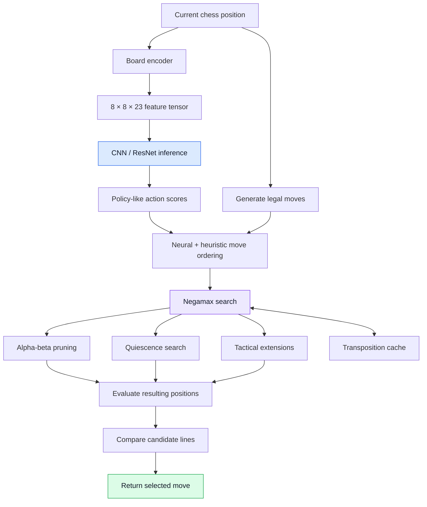
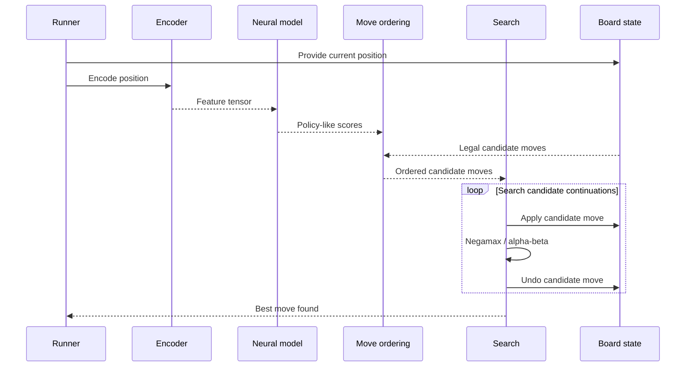

# ♟ Chess AI --- Neural-Guided Search Engine

### A hybrid chess engine combining a ResNet-based model with classical adversarial search

```


------------------------------------------------------------------------

## Contents

-   [Project at a glance](#-project-at-a-glance)
-   [Quick demo](#-quick-demo)
-   [Why a hybrid engine?](#-why-a-hybrid-engine)
-   [System architecture](#-system-architecture)
-   [End-to-end move lifecycle](#-end-to-end-move-lifecycle)
-   [Board representation](#-board-representation)
-   [Move/action encoding](#-moveaction-encoding)
-   [Neural network and inference](#-neural-network-and-inference)
-   [Search and decision-making](#-search-and-decision-making)
-   [Move-ordering heuristics](#-move-ordering-heuristics)
-   [Project structure](#-project-structure)
-   [Running the project](#-running-the-project)
-   [Models and large files](#-models-and-large-files)
-   [Testing and evaluation](#-testing-and-evaluation)
-   [Engineering notes and known
    limitations](#-engineering-notes-and-known-limitations)
-   [Roadmap](#-roadmap)
-   [Demo checklist](#-demo-checklist)


```

------------------------------------------------------------------------

## 🔎 Project at a glance

Chess AI is an experimental hybrid chess engine built around two
complementary ideas:

1.  **Learned guidance:** a CNN/ResNet model processes an encoded board
    position and produces policy-like scores for possible actions.
2.  **Explicit search:** a Negamax-based search examines move
    continuations, using alpha-beta pruning and tactical search
    techniques to focus computation.

The supplied search implementation uses neural inference primarily for
**move ordering**. This distinction matters: the network helps rank
candidate moves, while the search algorithm explores resulting
positions. The code should not be described as a complete AlphaZero
implementation or as a neural value evaluator unless that behavior is
separately implemented and verified.

### At a glance

  -----------------------------------------------------------------------
  Component                           Role
  ----------------------------------- -----------------------------------
  Position encoder                    Converts board state into a
                                      multi-channel numerical tensor

  CNN / ResNet artifacts              Provide learned features and
                                      policy-like model output

  Action encoder                      Maps chess moves into a fixed
                                      4,672-action space

  Move ordering                       Combines model scores with tactical
                                      adjustments

  Negamax                             Searches adversarial move sequences

  Alpha-beta pruning                  Cuts branches that cannot improve
                                      the current result

  Quiescence search                   Extends selected tactical
                                      continuations beyond the nominal
                                      horizon

  Transposition cache                 Attempts to reuse results for
                                      repeated positions

  Iterative deepening                 Searches increasing depths

  Test scripts                        Provide entry points for model and
                                      engine experiments
  -----------------------------------------------------------------------

> **Reproducibility note:** reported training scale (\~14 million moves)
> and playing strength (\~1500 Elo) are project-reported figures, not
> independently verified benchmarks. See [Testing and
> evaluation](#-testing-and-evaluation) for what would be needed to
> substantiate them.

------------------------------------------------------------------------

## 🎬 Quick demo

> **Add your real demo here.** A short recording of a position being
> evaluated and a move being selected is more convincing than a
> decorative screenshot.

```{=html}
<!-- Recommended: save a short GIF as assets/chess-ai-demo.gif, commit it, and uncomment the next line. -->
```
```{=html}
<!--  -->
```
**Demo video:** *Add a link to your uploaded video here.*

### What the demo should show

1.  The engine loads the model.
2.  A position is presented to the engine.
3.  Legal candidate moves are generated.
4.  The neural model contributes policy-like move scores.
5.  Move ordering combines those scores with tactical heuristics.
6.  Search examines candidate continuations.
7.  The engine returns its selected move.

If available, show the position in a chessboard UI and display the
chosen move, elapsed time, search depth, and evaluation. Only display
metrics that the program actually measures.

------------------------------------------------------------------------

## 🧩 Why a hybrid engine?

A chess engine must choose a move in a game tree where each move creates
more possible replies. Exhaustively exploring the tree is infeasible
beyond shallow depths.

There are two broad approaches:

-   **Search-first systems** use explicit rules and evaluation to
    examine continuations.
-   **Learning-based systems** use a model trained on examples or
    self-play to estimate promising actions or positions.

This project explores a hybrid: use a learned signal to improve the
order in which search considers moves, while retaining classical search
to compare the consequences.


```

```
Alpha-beta pruning is most effective when promising moves are examined
early. If a strong move quickly establishes a useful bound, the search
may be able to skip many alternatives.

A policy-like model can help rank moves before the engine spends more
time exploring them. But a model ranking is not a proof that a move is
best: a low-ranked move may still be tactically critical. The search
depth, candidate limit, heuristic adjustments, and correctness of the
search all influence the final result.

```{=html}
</details>
```

------------------------------------------------------------------------

## 🏗 System architecture

The following diagram describes the intended relationship between the
components in the supplied source. It is a logical architecture diagram,
not a claim that every integration path currently runs successfully end
to end.



### Architectural responsibilities

  -----------------------------------------------------------------------
  Layer             Input             Output            Responsibility
  ----------------- ----------------- ----------------- -----------------
  Position encoding Board and game    Numerical tensor  Make state usable
                    state                               by the network

  Neural inference  Encoded position  Model outputs     Produce learned
                                                        action guidance

  Legal move        Position          Legal moves       Keep search
  generation                                            within legal
                                                        chess moves

  Move ordering     Legal moves +     Ordered           Try promising
                    scores            candidates        moves earlier

  Search            Ordered moves +   Scores and best   Explore
                    position          move              adversarial
                                                        continuations

  Search            Search state      Fewer/reused      Reduce redundant
  optimizations                       nodes             or unnecessary
                                                        work

  Runner /          User input or     Chosen move       Connect
  interface         initial position                    configuration,
                                                        model, and search
  -----------------------------------------------------------------------

### End-to-end move lifecycle



**Important:** this sequence explains the intended data flow. The actual
runtime should be verified after resolving the integration issues listed
later in this README.

------------------------------------------------------------------------

## ♟ Board representation

The supplied `encoding.py` implements a board representation with **23
feature planes**, each corresponding to an 8 × 8 board grid.

The conceptual tensor shape is:

\[ 8 `\times 8`{=tex} `\times 23`{=tex} \]

The documented channels represent these categories:

  Channel(s)   Meaning
  ------------ -----------------------------------
  0--5         Piece planes for the side to move
  6--11        Piece planes for the opponent
  12--15       Castling-right information
  16           En-passant target
  17           Halfmove clock
  18           Fullmove number
  19--20       Attack-map features
  21           Repetition indicator
  22           Check status

The encoder canonicalizes the position by mirroring the board vertically
when Black is to move. This attempts to give the network a more
consistent perspective: the current player is represented in the same
relative orientation.


```
Piece placement alone does not fully describe a chess position. Castling
rights, en-passant availability, move counters, repetition context, and
whether a king is in check can affect legal moves or game outcomes.

Encoding these features gives the model additional context. Their exact
implementation and tensor compatibility should be verified against the
model used at inference time.


```
> **Source consistency note:** a source docstring reportedly mentions 22
> channels, while the implementation allocates 23. Confirm the model's
> expected input shape and make the encoder documentation consistent
> before presenting this as a stable interface.

------------------------------------------------------------------------

## 🔢 Move/action encoding

The project includes an AlphaZero-style action representation with
**4,672 possible action indices**:

\[ 64 `\times 73`{=tex} = 4,672 \]

The idea is to associate each of the 64 starting squares with 73 move
planes. Those planes encode directional moves, knight moves, and
promotion-related moves.

This creates a fixed-size output space for the policy-like model.

It does **not** mean that a chess position has 4,672 legal moves. The
search should only consider moves legal in the current position and map
those moves into the action space.


```
A neural network generally needs a consistent output shape across
examples. A fixed action space provides one output index per
representable action pattern, even though the set of legal moves changes
from position to position.

The engine then looks up scores for the legal moves available in the
current position. Correctness depends on the encoder and decoder using
the same action-index convention.


```
**Implementation caveat:** the project also contains a separate
`engine/move_ordering.py` with a simpler from-square/to-square
representation. That representation should not be assumed to be
interchangeable with the 4,672-action encoding.

------------------------------------------------------------------------

## 🧠 Neural network and inference

The repository contains CNN and ResNet model artifacts. The supplied
search code invokes the model using a call shaped like:

``` python
policy_batch, _ = model.predict(tensor, verbose=0)
policy_scores = policy_batch[0]
```

The search consumes the first output as a policy-like score vector. The
second output is ignored in this code path.

### How the output is used

1.  Encode the current position.
2.  Run inference.
3.  Obtain policy-like scores.
4.  Map legal moves to action indices.
5.  Use those scores as one input to candidate ordering.
6.  Add the configured tactical adjustments.
7.  Search the ordered candidates.

The policy-like scores should not automatically be called calibrated
probabilities. That depends on the model architecture, training
objective, output activation, and post-processing.

### Model artifacts

  File                          Format     Reported size
  ----------------------------- -------- ---------------
  `models/cnn_model.h5`         HDF5            73.46 MB
  `models/resnet_model.h5`      HDF5            79.94 MB
  `models/resnet_model.keras`   Keras           75.77 MB

These artifacts are intentionally excluded from the source-only Git
repository. A fresh clone therefore does not include the trained
weights.

The project should eventually document which artifact is the recommended
model, how it was trained, the expected input shape, output shapes,
dependencies, and a checksum or version identifier.

------------------------------------------------------------------------

## 🔍 Search and decision-making

### 1. Negamax

Negamax is the core adversarial-search formulation in the supplied
`searching.py`.

In a two-player zero-sum game, the value from one player's perspective
is the negative of the value from the opponent's perspective. Negamax
uses that symmetry to simplify the search:

\[ N(s) = `\max`{=tex}\_{m `\in `{=tex}M(s)}
`\left[-N(s_m)\right]`{=tex}\]

Where:

-   \(s\) is the current position.
-   (M(s)) is the set of legal moves.
-   (s_m) is the position after applying move (m).

The search considers a move, recursively evaluates the opponent's
responses, and compares the resulting scores. The best move is the
candidate with the strongest score under the search's evaluation and
depth limits.

### 2. Alpha-beta pruning

Alpha-beta pruning avoids exploring branches that cannot change the
current decision.

-   **Alpha** represents the best score the current side can already
    guarantee.
-   **Beta** represents the relevant bound from the opponent's
    alternatives.
-   When `alpha >= beta`, the remaining alternatives in that branch can
    be pruned.

The amount of pruning depends strongly on move ordering. Strong
candidates examined early can establish useful bounds earlier.

This is the key interaction between the learned model and classical
search: the model can influence which moves are explored first, and
alpha-beta pruning can then reduce work when the ordering is effective.

### 3. Iterative deepening

The search progressively attempts deeper searches:

``` text
Depth 1 → first result
Depth 2 → more lookahead
Depth 3 → deeper lookahead
...
```

This approach can produce a move from a completed shallower iteration if
a deeper iteration cannot finish within the available time.

The supplied runner uses a default seven-second move budget and requests
depths up to six. These are configuration defaults, not guarantees of
completed depth or playing strength.

The supplied code appears to have iterative deepening at two levels,
which can repeat work. Consolidating it into one clear
iterative-deepening loop would improve maintainability and make timing
behavior easier to reason about.

### 4. Quiescence search

A nominal depth limit can stop in the middle of a tactical sequence. A
static evaluation at that point may be misleading because a capture or
recapture is still available.

Quiescence search extends selected tactical lines beyond the regular
horizon. The supplied implementation considers captures, checks, and
promotions.

The purpose is to reduce the chance of evaluating an unstable position
as if its tactical sequence were finished.

Quiescence search must be bounded carefully. The supplied implementation
should be reviewed for a separate maximum quiescence depth or another
robust termination strategy, particularly in positions involving
repeated checks.

### 5. Tactical extensions

The search contains selective extensions for certain tactical
situations, including checks and tactical moves. The idea is to devote
extra lookahead to lines where a strict depth cutoff could miss an
important consequence.

Extensions can improve tactical visibility, but they also increase the
search tree. Their criteria and limits should be explicit and tested.

### 6. Transposition caching

Different move orders can reach the same position. A transposition table
attempts to avoid recomputing the search for a position already
encountered.

A robust table generally needs to account for:

-   Position identity, including relevant rights and state.
-   Search depth.
-   Score.
-   Entry type: exact value, lower bound, or upper bound.
-   Best move, when useful for move ordering.

The supplied implementation stores depth and score but does not
distinguish alpha-beta bound types. Reusing such entries as exact scores
can make the search incorrect. This is a high-priority correctness
improvement.

------------------------------------------------------------------------

## 🎯 Move-ordering heuristics

The supplied search combines the neural policy-like score with
hand-designed adjustments.

  Move feature                                   Adjustment
  ------------------------------------- -------------------
  Capture                                           `+1000`
  Gives check                                        `+500`
  Promotion                                          `+800`
  Early queen move before fullmove 10               `−1000`
  Neural score                            Scaled by `10000`

The exact values are heuristic weights, not probabilities or learned
quantities.

The model-guided path uses a top-20 candidate limit. This reduces the
number of candidates explored through that path, but creates a
trade-off: if a strong move is ranked outside the retained set, the
engine may never examine it in that search stage.

At deeper plies, the supplied code uses a simpler captures-first
fallback rather than invoking the neural model at every node.

```
```
A small candidate set reduces inference and search work. A large
candidate set retains more alternatives but costs more time. The best
setting depends on model ranking quality, branching factor, time
control, and search implementation.

A useful experiment is to compare identical search settings with neural
move ordering enabled and disabled, then measure nodes searched, move
latency, and game results over a sufficiently large test set.

```
```

------------------------------------------------------------------------

## 🗂 Project structure

The following tree reflects the files identified in the supplied
project. Some directories may contain additional local files not tracked
by Git.

``` text
Chess-ai/
│
├── engine/
│   ├── __init__.py
│   ├── model_loader.py       # Model-loading helper (integration needs review)
│   └── move_ordering.py      # Separate/simpler move-ordering implementation
│
├── models/                   # Local trained models; not committed
│   ├── cnn_model.h5
│   ├── resnet_model.h5
│   └── resnet_model.keras
│
├── data/                     # Local data, if present; not committed
├── datasets/                 # Local datasets, if present; not committed
│
├── run_engine.py             # Main runner / configuration entry point
├── searching.py              # Negamax, alpha-beta and search orchestration
├── encoding.py               # Position-to-tensor encoding
├── move_encoding.py          # Fixed action-space encoding
├── evaluator.py              # Evaluation-related code; integration needs review
├── board_utils.py            # Board-related helpers
│
├── test.py                   # General test entry point
├── test_cnn.py               # CNN-related tests
├── test_engine.py            # Engine tests
├── test_vs_stockfish.py      # Engine-versus-Stockfish test entry point
├── advanced_chess_test.py    # Additional chess tests
│
├── chess_model_battle_results.csv
├── model_vs_model_results.txt
├── .gitignore
└── README.md
```

### Module guide

```
```
The supplied runner configures the model path and calls the search to
find a move. It currently contains an absolute Windows model path:

`D:/chess-ai/models/resnet_model.keras`

That path will not work on another machine without modification. Prefer
a path relative to the project root or a configurable command-line
argument/environment variable.

```
```
This is the core search module. The supplied code includes Negamax with
alpha-beta, move ordering, quiescence search, tactical extensions,
transposition caching, and iterative deepening.

It also imports `evaluate_advanced`, which is not defined in the
supplied `evaluator.py`. Resolve that integration before treating the
search as runnable end to end.

```
```
Transforms a chess position into a multi-plane tensor. It includes piece
planes and additional state features such as castling, en passant,
counters, attack maps, repetition, and check status. Verify that the
resulting tensor shape matches the saved model's expected input.

```
```
Maps chess moves into an AlphaZero-style fixed action space of 4,672
indices. Correctness requires the encoder and decoder to agree exactly
on how moves map to action indices.

```
```
The supplied evaluator imports `ChessEngine` from `engine` and appears
oriented toward an MCTS-style interface. That does not align cleanly
with the Negamax search imports identified in `searching.py`. Clarify
the intended interface and consolidate evaluation responsibilities.

```
```
The supplied loader contains a naming collision in which a helper
appears to call itself recursively. Rename the imported loader or helper
and add a small test that loads the selected model once.

```
```
The repository contains scripts for general testing, CNN testing, engine
testing, Stockfish matches, and advanced chess tests. Their existence
does not by itself establish that all tests pass. Document the command
and expected output for each test once verified.

```
```

------------------------------------------------------------------------

## 🚀 Running the project

### Prerequisites

-   Python version compatible with the project's imports.
-   TensorFlow/Keras version compatible with the saved model.
-   The chess library and other dependencies used by the source.
-   A local copy of the required model artifact.
-   Stockfish installed and configured if running
    engine-versus-Stockfish tests.

### 1. Clone the repository

``` bash
git clone https://github.com/SakshamJuneja007/Chess-ai.git
cd Chess-ai
```

### 2. Create a virtual environment

**Windows PowerShell**

``` powershell
python -m venv .venv
.\.venv\Scripts\Activate.ps1
python -m pip install --upgrade pip
```

### 3. Install dependencies

A tested `requirements.txt` should be added to the repository. Until it
exists, install the dependencies required by the actual imports and use
compatible TensorFlow/Keras versions.

Avoid assuming that installing the newest version of every dependency
will load an older saved model correctly.

### 4. Add the model files locally

Place the required model artifact under `models/`. The model files are
excluded from Git and are not included in a fresh clone.

### 5. Configure the model path

Update the absolute model path in `run_engine.py` to point to the local
artifact, or preferably change the runner to construct a path relative
to the project directory.

### 6. Run

``` powershell
python run_engine.py
```

> **Known status:** the supplied source has integration issues involving
> the evaluator import and model loader. The command above is the
> intended entry point, not a guarantee that the current checkout starts
> successfully without fixes.

### 7. Run tests

Once dependencies and the integration issues are resolved, test scripts
can be invoked individually, for example:

``` powershell
python test_engine.py
python test_cnn.py
python test_vs_stockfish.py
```

Check each script's actual arguments and requirements before running it;
Stockfish tests need a configured Stockfish executable.

------------------------------------------------------------------------

## 📦 Models and large files

Large artifacts are intentionally kept out of the source-only Git
history.

The `.gitignore` rules cover virtual environments, Python caches, model
formats such as `.h5`, `.keras`, `.pt`, `.pth`, `.pkl`, and `.joblib`,
as well as data/dataset/model directories and generated output folders.

This keeps normal Git operations focused on source code rather than
large binary artifacts.

For a reproducible release, document:

-   Which model file is the supported inference model.
-   How to obtain it securely.
-   Model input and output signatures.
-   The model's training dataset and objective.
-   Dependency versions.
-   A checksum or model version.
-   Whether the model can be regenerated from public training scripts.

------------------------------------------------------------------------

## 🧪 Testing and evaluation

The project includes test entry points, including
`test_vs_stockfish.py`. The supplied file inventory also identifies
result artifacts such as `chess_model_battle_results.csv` and
`model_vs_model_results.txt`.

This README does not infer benchmark results from the mere presence of
those files.

### How to make an Elo claim credible

A useful engine-strength report should state:

-   The opponent and exact version.
-   The number of games.
-   The time control and hardware.
-   Whether the engine played both colors.
-   Wins, draws, and losses.
-   The rating-estimation method and uncertainty.
-   The engine configuration, including search depth/time budget and
    model version.

A claimed Elo is only meaningful relative to the opponent, conditions,
and sample size. Treat the reported \~1500 Elo as a preliminary project
estimate until a repeatable evaluation supports it.

### Recommended experiments

  -----------------------------------------------------------------------
  Experiment              Measure                 What it reveals
  ----------------------- ----------------------- -----------------------
  CNN vs. ResNet          Results over the same   Which model performs
                          match set               better in the same
                                                  conditions

  Neural ordering on/off  Game results and move   Whether learned
                          latency                 ordering adds value

  Different candidate     Strength and time per   Speed/coverage
  limits                  move                    trade-off

  Different search depths Results, nodes, and     Impact of additional
                          latency                 lookahead

  Stockfish match series  W/D/L and rating        More credible strength
                          estimate                evidence

  Search correctness      Best move on tactical   Whether search changes
  tests                   positions               preserve expected
                                                  behavior
  -----------------------------------------------------------------------

------------------------------------------------------------------------

## 🛠 Engineering notes and known limitations

A strong project README should make limitations visible. The following
items were identified in the supplied source and should be addressed
before presenting the engine as a stable, reproducible application.

  -----------------------------------------------------------------------------------------
  Priority          Area              Observation                     Recommended action
  ----------------- ----------------- ------------------------------- ---------------------
  High              Evaluator         Search imports                  Define one evaluation
                    integration       `evaluate_advanced`, which is   interface and test it
                                      not defined in the supplied     
                                      evaluator                       

  High              Model loader      Helper/import naming conflict   Rename functions and
                                      appears to cause recursive      add a model-load
                                      self-calls                      smoke test

  High              Feature tensor    Documentation says 22 channels  Verify model input
                                      in one place, while code        shape and update
                                      allocates 23                    docs/tests

  High              Transposition     Entries do not store            Implement bound-aware
                    table             exact/lower-bound/upper-bound   entries and safe
                                      type                            probe logic

  Medium            Search control    Iterative deepening appears at  Consolidate search
                                      two levels                      control into one loop

  Medium            Quiescence        No separate maximum quiescence  Add termination
                                      depth is apparent               limits and tactical
                                                                      regression tests

  Medium            Portability       Runner uses an absolute Windows Use a configurable
                                      path                            project-relative
                                                                      model path

  Medium            Reproducibility   Dependency pins and full        Add requirements and
                                      training procedure are not      training/evaluation
                                      documented                      documentation

  Medium            Benchmarks        Elo claim lacks a documented    Publish match
                                      protocol in the available       settings and results
                                      description                     with uncertainty
  -----------------------------------------------------------------------------------------

These are not cosmetic issues. Evaluator integration and model loading
affect whether the engine can run; search correctness affects whether
its returned scores and decisions can be trusted.

------------------------------------------------------------------------

## 🗺 Roadmap

-   [ ] Fix evaluator and search interfaces.
-   [ ] Fix the model loader and add a load smoke test.
-   [ ] Verify the board tensor shape against the saved model.
-   [ ] Add unit tests for move/action encoding round trips.
-   [ ] Consolidate iterative deepening.
-   [ ] Implement transposition-table bound types.
-   [ ] Bound quiescence search and add tactical regression tests.
-   [ ] Replace absolute paths with configurable paths.
-   [ ] Add pinned dependencies.
-   [ ] Document the training pipeline and model outputs.
-   [ ] Automate repeatable Stockfish match evaluation.
-   [ ] Publish a demo recording and verified benchmark results.

------------------------------------------------------------------------

## 🎤 Demo checklist

Use this checklist before showing the project to another developer.

```
```
-   [ ] Fresh clone instructions have been tested.
-   [ ] Dependencies are documented.
-   [ ] The selected model loads successfully.
-   [ ] A legal move is returned for a known position.
-   [ ] The engine handles checkmate, stalemate, and promotion
    positions.
-   [ ] Errors are reported clearly.

``
```
-   [ ] Explain the 23-plane board representation.
-   [ ] Explain how legal moves map to the 4,672-action space.
-   [ ] Show how model scores affect move ordering.
-   [ ] Explain Negamax and alpha-beta pruning with one small example.
-   [ ] Explain quiescence search and its stopping condition.
-   [ ] Explain what is cached in the transposition table.
-   [ ] Clearly distinguish measured results from estimates.

```
```
-   [ ] Add a short actual gameplay recording.
-   [ ] Include the exact command used to run the demo.
-   [ ] Record Python and model-library versions.
-   [ ] Publish match count and W/D/L for Stockfish tests.
-   [ ] State hardware and time controls for performance claims.

```
```

------------------------------------------------------------------------

## 👤 Author

**Saksham Juneja**

-   GitHub: [@SakshamJuneja007](https://github.com/SakshamJuneja007)
-   Project: [Chess-ai](https://github.com/SakshamJuneja007/Chess-ai)

------------------------------------------------------------------------

::: {align="center"}
**Chess AI --- learned move guidance, classical search, and ongoing
engineering.**
:::
